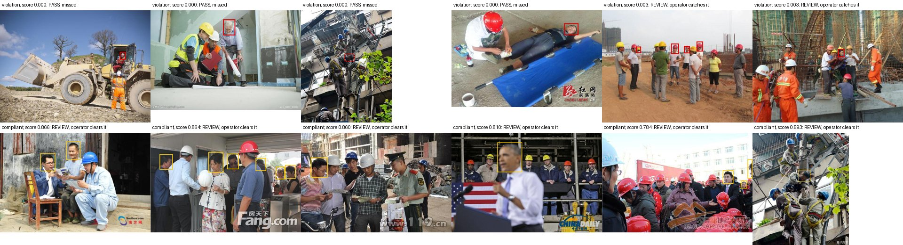
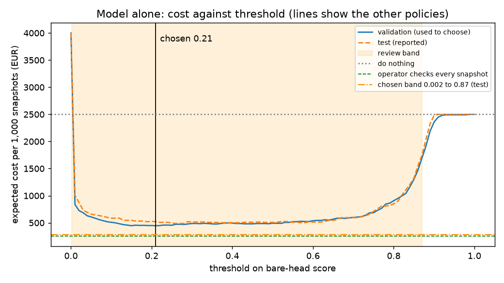

# Assignment 2 Report

- **Name**: Hugo Marsiglia
- **Student ID**: 19610
- **Email**: hmarsiglia.ieu2022@student.ie.edu
- **Group**: BBADBA 5A

## Business problem, and the cost of being wrong

**Decision.** A site has 10 cameras, each taking one snapshot a minute for 10 hours (6,000 snapshots a
day). For each snapshot the system decides: **PASS** (no action), **REVIEW** (a monitoring operator looks at it, about
10 seconds) or **FAIL** (alert: the site supervisor goes out and stops the worker). The positive
class is a snapshot with at least one bare head.

A monitoring operator reviews uncertain snapshots, and the site supervisor responds to alerts and stops unsafe work. A
missed bare head leaves someone exposed to injury and creates potential costs for the company, whereas a false alarm
wastes the supervisor's time. Under the assumed costs, one miss equals €50 ÷ €4 = 12.5 false alarms.

| Outcome | Cost per snapshot |
|---|---:|
| Missed bare head (FN) | €50 |
| Supervisor sent for nothing (FP) | €4 |
| Supervisor stops a real violation (TP) | €4 |
| Compliant snapshot passed (TN) | €0 |
| One operator review | €0.056 |

Where each figure comes from is in [Cost matrix and operating point](#cost-matrix-and-operating-point).

## Dataset

- **Roboflow Universe:** workspace `joseph-nelson`, project `hard-hat-workers`, **version 5** (`raw_HeadHelmetClasses`):
  https://universe.roboflow.com/joseph-nelson/hard-hat-workers/dataset/5
- **Licence:** Public Domain. The images come from Northeastern University (China), Harvard Dataverse doi:10.7910/DVN/7CBGOS.
- **One image:** one photo of people, mostly at building sites. In this framing, one camera snapshot.
- **Classes:** `head` (a head without a helmet, the positive class) and `helmet` (a head with a helmet). A snapshot
  with only `helmet` boxes is compliant.
- **Images:** 7,035 raw photos (not resized, most 500 px wide), split 70/20/10.

Hard Hat Workers v5 has the two relevant classes (bare heads and helmets) and enough compliant and violation photos in
validation and test to measure both misses and false alarms. I rejected the parcel dataset because validation and test
contained no intact parcels, so I could not measure false alarms or reliably compare the costs of different policies.

How the dataset was chosen. A version was accepted only if it was public and not private, object detection with at
least 2 classes, had at least 50 violation and 50 compliant images in both validation and test, and a test split of
about 200 images or more, all checked from the downloaded labels:

| Candidate | Result | Reason |
|---|---|---|
| `apizedamagedboxes/apizee_damagedpackages` v10 (parcel damage) | Rejected | 0 intact images in validation and in test (60 in train). Licence: Private |
| `roboflow-universe-projects/construction-site-safety` v30 | Rejected | 82 test images; tiny objects (median hard hat 0.2% of the image) |
| `workspace-4nvpa/welding_defects-vwoj6` v1 | Rejected | 74 test images |
| `smart-damage-detection-.../damage-detection-for-packages-dspra` v6 | Rejected | 12 test images |
| `joseph-nelson/hard-hat-workers` v10 (head, helmet, person) | Not used | Same images as v5; `person` labelled on only 23 of 706 test images |
| `joseph-nelson/hard-hat-workers` v5 (head, helmet) | **Chosen** | Validation 256 violation / 1157 compliant; test 140 / 566 |

## What the dataset's composition implies

| Split | Images | With a bare head | All helmeted | Bare-head share | `head` boxes | `helmet` boxes |
|---|---:|---:|---:|---:|---:|---:|
| train | 4,916 | 911 | 4,005 | 18.5% | 4,612 | 13,919 |
| val | 1,413 | 256 | 1,157 | 18.1% | 1,339 | 3,913 |
| test | 706 | 140 | 566 | 19.8% | 726 | 1,915 |

Object size, as box area relative to the image:

| Class | 10th percentile | Median | 90th percentile | Boxes under 1% of the image |
|---|---:|---:|---:|---:|
| head | 0.22% | 0.60% | 1.96% | 72% |
| helmet | 0.22% | 0.83% | 4.86% | 56% |

- Near-duplicates (64-bit difference hash within 4 bits of a training image): 19 test
  images (2.7%) and 51
  validation images (3.6%).
- Every image has at least one labelled head or helmet: there are no empty scenes.
- The costs below are computed at an assumed production base rate of 5%, not at the test split's
  19.8%.

I trust the reported split counts, annotated object sizes and evaluation results as descriptions of this dataset,
subject to its label errors. However, the 19.8% test violation rate does not establish the real site rate, and
reweighting it to an assumed 5% does not correct differences in camera views or people's appearance. The news photos,
meetings and suits-versus-workwear pattern differ from site CCTV, and some bare heads may be in places where helmets
are unnecessary, so I cannot conclude that the same accuracy or costs will hold on site.

## Finetuning and baselines

**Model and task:** object detection, `yolo11n` finetuned from its COCO checkpoint.
**Where and how:** on my own Mac (Apple M4 Pro, GPU through MPS), 20
epochs in 57 minutes. Image size 640, batch 16, AdamW with learning rate 0.00167
(chosen automatically by Ultralytics 8.4.173), patience 15, seed 0, torch 2.11.0.
Mosaic augmentation was switched off for the last 10 epochs (the Ultralytics default). The best epoch was the last one.
Validation mAP50 went from 0.911 after epoch 1 to 0.958 after epoch 10 and
0.970 after epoch 20. `uv run python main.py train` reproduces the run.

All three models were scored on the same 706 test images by the same evaluator. The image-level
columns treat a snapshot as flagged when its score (the highest `head` confidence) reaches the model-alone threshold
0.21; the COCO model has no `head` class, so its snapshot score is its highest `person` confidence.

| Model | mAP50 | mAP50-95 | Violation recall | Violation precision | Snapshot ROC-AUC | € per 1,000 snapshots |
|---|---:|---:|---:|---:|---:|---:|
| Finetuned yolo11n | 0.968 | 0.675 | 92.1% | 86.0% | 0.967 | €522 |
| COCO yolo11n, zero-shot | 0.000 | 0.000 | 100.0% | 20.2% | 0.677 | €3,913 |
| Predict nothing (trivial) | 0.000 | 0.000 | 0.0% | n/a | 0.500 | €2,500 |

Cross-check: Ultralytics' own validator on the same test split gives mAP50 0.970
and mAP50-95 0.679.

I expected a large improvement because the fine-tuned model learned the relevant classes. COCO scores zero on this
detection task because it has neither a bare-head nor a helmet class, while predicting nothing necessarily detects
nothing. These are limited baselines, so the gap demonstrates useful task learning but does not establish deployment
readiness; the model alone still misses about 8% of violation snapshots.

## Per-class evaluation and failure modes

Positive class: `head` (bare head). Test split, precision and recall at the best-F1 confidence and at the operating
threshold 0.21:

| Class | Test boxes | Precision | Recall | AP50 | AP50-95 | Precision @ 0.21 | Recall @ 0.21 |
|---|---:|---:|---:|---:|---:|---:|---:|
| head (positive) | 726 | 0.935 | 0.934 | 0.955 | 0.670 | 0.868 | 0.956 |
| helmet | 1,915 | 0.956 | 0.930 | 0.980 | 0.680 | 0.889 | 0.967 |

Box confusion matrix on test (confidence 0.25, IoU 0.5). Rows are predictions, columns the truth:

|  | true head | true helmet | true background |
|---|---:|---:|---:|
| predicted head | 692 | 5 | 87 |
| predicted helmet | 14 | 1,844 | 184 |
| predicted background | 20 | 66 | 0 |

Share of labelled bare heads found (confidence 0.25, IoU 0.5), by head size and by crowd size:

| Group | Labelled bare heads | Found | Share found |
|---|---:|---:|---:|
| small head (<0.25% of image) | 81 | 67 | 83% |
| medium head (0.25-1%) | 442 | 432 | 98% |
| large head (>1%) | 203 | 195 | 96% |
| 1-3 people in photo | 34 | 29 | 85% |
| 4-8 people in photo | 343 | 331 | 97% |
| 9+ people in photo | 349 | 334 | 96% |



*Top row: the 6 violation snapshots the model scores lowest. Bottom row: the 6 compliant snapshots it scores highest.
Red: labelled bare head. Yellow: predicted bare head (confidence 0.25 or more).*

Helmet AP50 of 0.980 lifts the overall mAP50 above the safety-critical bare-head AP50 of 0.955, because the two classes
receive equal weight. The clearest weakness is small or difficult heads: detection falls to 83% for small heads versus
98% for medium heads, and 14 bare heads were incorrectly classified as helmets. The four missed snapshots show problems
with distance, grey hair, surrounding cables and an unusual lying-down pose; meanwhile, many apparent false alarms are
real bare heads missing from the annotations.

## Cost matrix and operating point

| Figure | Value | Source or reasoning |
|---|---:|---|
| Missed bare head (FN) | €50 | Expected fine plus expected injury cost. Not making workers use protective equipment is a serious infraction (LISOS, RDL 5/2000, art. 12.16 f); serious fines run from €2,451 to €49,180 (art. 40.2). Assumed 1% chance that a violation is caught by an inspection or client audit: about €25. Assumed 1 in 4,000 chance of a serious head injury costing about €100,000: about €25. For scale, the average work accident costs a Spanish firm about €23,000 (Mutua Universal, 2007 to 2011). |
| Supervisor sent for nothing (FP) | €4 | About 10 minutes of a site supervisor at about €25 an hour: €25,000 to €30,000 gross a year plus about 37% employer social security, over about 1,736 hours |
| Supervisor stops a violation (TP) | €4 | The same walk, now useful |
| Compliant snapshot passed (TN) | €0 | Nothing happens |
| One review | €0.056 | 10 seconds of an operator at €20 an hour (assumed) |
| Base rate | 5% | Assumed share of snapshots with a bare head. Published inspections report much worse compliance (fewer than half of workers wearing head protection at 161 Saskatchewan residential sites; 15% to 60% non-compliance on 7 of 18 sites in a multi-site study), but a site with cameras and supervisors should do far better. Tested from 1% to 15%. |
| Volume | 6,000 a day | 10 cameras x 1 snapshot a minute x 10 hours |
| Review capacity | 1 operator | One productive shift of 6.5 hours |

Sources: LISOS consolidated text, BOE (https://www.boe.es/buscar/act.php?id=BOE-A-2000-15060). Mutua Universal accident
cost study (https://test.amat.es/wp-content/uploads/2021/03/estudio-de-costes-de-los-accidentes-laborales-2007-2011.pdf).
Supervisor pay (https://www.etalentum.com/en/candidates/job-offer/21607/encargado/a-obra-edificacion.html). Employer
contribution rates (https://www.cuestioneslaborales.es/porcentaje-de-cotizacion-a-la-seguridad-social-del-trabajador-y-empresa/).
Saskatchewan inspections (https://www.hrreporter.com/focus-areas/safety/inspections-at-saskatchewan-construction-sites-raise-safety-concerns/301875).
Multi-site study (https://elcosh.org/document/1435/693/d000055/results.html).

**How a threshold is costed.** The rates per outcome come from the evaluated split; the mix of violation and compliant
snapshots comes from the base rate p. A reviewed snapshot is assumed to be decided correctly by the operator.

```
cost per snapshot = p     x [ P(pass|violation) x FN + P(fail|violation) x TP + P(review|violation) x (review + TP) ]
                  + (1-p) x [ P(fail|compliant) x FP + P(pass|compliant) x TN + P(review|compliant) x (review + TN) ]
```

**The sweep.** Every threshold from 0 to 1 in steps of 0.01 was costed for the model deciding alone, and every pair of
thresholds (with extra steps below 0.01) for the three-outcome design, on the validation split. The cheapest choice on
validation was then costed once on test. The 95% intervals come from 2,000 bootstrap resamples of the test images.



| Design | Thresholds (chosen on validation) | Validation € per 1,000 | Test € per 1,000 | Test 95% interval |
|---|---|---:|---:|---|
| Model decides alone | fail at 0.21 or above | €447 | €522 | €410 to €643 |
| Model + review band | pass below 0.002, fail at 0.87 or above | €237 | €284 | €233 to €351 |

Sensitivity: one assumption changed at a time, thresholds re-chosen on validation, cost on test (€ per 1,000 snapshots):

| Scenario | Band | Model + review | Check everything | Model alone | Do nothing | To operator | Operators | Violations caught |
|---|---|---:|---:|---:|---:|---:|---:|---:|
| base case | 0.002 to 0.87 | €284 | €256 | €522 | €2,500 | 32.8% | 0.84 | 97.1% |
| base rate 1% | 0.01 to 0.87 | €79 | €96 | €137 | €500 | 17.7% | 0.46 | 93.6% |
| base rate 2% | 0.01 to 0.87 | €149 | €136 | €241 | €1,000 | 18.2% | 0.47 | 93.6% |
| base rate 3% | 0.01 to 0.87 | €219 | €176 | €330 | €1,500 | 18.6% | 0.48 | 93.6% |
| base rate 8% | 0.002 to 0.87 | €444 | €376 | €758 | €4,000 | 33.8% | 0.87 | 97.1% |
| base rate 15% | 0.002 to 0.87 | €817 | €656 | €1,255 | €7,500 | 36.1% | 0.92 | 97.1% |
| missed bare head costs EUR 10 | 0.15 to 0.87 | €226 | €256 | €274 | €500 | 7.5% | 0.19 | 92.9% |
| missed bare head costs EUR 25 | 0.01 to 0.87 | €278 | €256 | €373 | €1,250 | 19.5% | 0.50 | 93.6% |
| missed bare head costs EUR 100 | 0.002 to 0.87 | €355 | €256 | €724 | €5,000 | 32.8% | 0.84 | 97.1% |
| missed bare head costs EUR 200 | 0.002 to 0.87 | €498 | €256 | €1,081 | €10,000 | 32.8% | 0.84 | 97.1% |
| review takes 5 s | 0.002 to 0.87 | €275 | €228 | €522 | €2,500 | 32.8% | 0.42 | 97.1% |
| review takes 20 s | 0.01 to 0.87 | €370 | €311 | €522 | €2,500 | 19.5% | 1.00 | 93.6% |
| review takes 30 s | 0.15 to 0.87 | €377 | €367 | €522 | €2,500 | 7.5% | 0.58 | 92.9% |
| false alert costs EUR 8 | 0.002 to 0.87 | €284 | €256 | €567 | €2,500 | 32.8% | 0.84 | 97.1% |
| caught violation costs EUR 8 | 0.01 to 0.87 | €546 | €456 | €706 | €2,500 | 19.5% | 0.50 | 93.6% |
| operator cap 0.5 people | 0.01 to 0.87 | €359 | €256 | €522 | €2,500 | 19.5% | 0.50 | 93.6% |
| no operator cap | 0.002 to 0.87 | €284 | €256 | €522 | €2,500 | 32.8% | 0.84 | 97.1% |

Break-even points, with every other assumption at its base value: the design beats doing nothing at every base rate
searched (down to 0.01%) and whenever a miss costs more than €4. It beats an operator
checking every snapshot only when the base rate is below 1.5% or a miss
costs less than €18.

I assumed €50 per missed snapshot to represent expected injury and enforcement costs, but this uncertain estimate would
strongly affect my recommendation. With other assumptions fixed, the sensitivity analysis says model plus review
becomes cheaper than checking everything if the miss cost drops below about €18, a reduction of 64%; alternatively,
the assumed violation rate would need to fall from 5% to below about 1.5%. The validation-selected thresholds (pass
below 0.002, review from 0.002 to below 0.87, and alert at 0.87 or above) produce an estimated test cost of €284 per
1,000 snapshots, but the €233 to €351 interval covers sampling uncertainty rather than all uncertainty about real
deployment.

## What a person still has to check

The chosen thresholds on the 706 test snapshots:

| Actual | PASS | REVIEW | FAIL (alert) |
|---|---:|---:|---:|
| Violation | 4 | 90 | 46 |
| Compliant | 390 | 176 | 0 |

At 6,000 snapshots a day and a 5% base rate: 32.8% of snapshots go to the
operator, that is **1,965 reviews a day**. At 10 seconds each that is
**5.5 hours a day**, or **0.84** of one operator's
6.5-hour shift. 97.1% of violation snapshots are caught by the model or
the operator, and 0.0% of compliant snapshots send the supervisor out.

| Policy | € per 1,000 snapshots | € per day | Sent to operator | Operators needed |
|---|---:|---:|---:|---:|
| Do nothing (no camera monitoring) | €2,500 | €15,000 | 0.0% | 0.00 |
| Operator checks every snapshot | €256 | €1,533 | 100.0% | 2.56 |
| Model decides alone (threshold 0.21) | €522 | €3,130 | 0.0% | 0.00 |
| Model + review band (0.002 to 0.87) | €284 | €1,703 | 32.8% | 0.84 |

The 0.84-operator estimate is mathematically reasonable as average workload, but reviewing nearly 2,000 snapshots daily
assumes sustained speed, reliable decisions and sufficient coverage for breaks and busy periods. Under the stated
assumptions, I would recommend checking everything if staffing permits: its estimated daily cost is €1,533 versus
€1,703 for model plus review, including supervisor visits for genuine violations. Under a strict one-operator limit, I
would pilot model plus review, but I would not approve autonomous deployment: the reported 97.1% capture rate and zero
false alerts depend on perfect human review and the dataset's labels.

## Limitations & next steps

- **Assumed base rate:** measure violation prevalence from representative site-camera footage, then recalculate costs
  and thresholds.
- **Unrepresentative imagery and clothing patterns:** collect CCTV showing both helmeted and bare-headed workers across
  clothing, distances, lighting and empty scenes, and evaluate on separate sites.
- **Label errors:** independently audit and correct validation and test annotations before repeating evaluation.
- **Perfect operator assumption:** run a realistic review trial and measure decision accuracy, review time and fatigue.
- **Overlapping snapshots:** group repeated appearances into incidents, suppress duplicate alerts and estimate costs
  per incident rather than repeatedly charging for the same violation.

## Generative AI use disclosure

I used generative AI extensively:

- **Claude (Anthropic), through Claude Code and the Claude app,** wrote all the code in `train.py`, `costing.py` and
  `app.py`, ran the training on my Mac and built the dashboard.
- Claude screened the candidate datasets against the acceptance rule above and found that the parcel dataset had no
  intact images in validation and test.
- Claude proposed the business framing, the cost figures and their sources, the base rate, the snapshot volume and the
  threshold-search method. I reviewed and confirmed each figure, and decided to keep €50 per missed snapshot (naming the
  overlap between snapshots as a limitation) and to cap review at one operator.
- Claude prepared a study guide with the results, pictures and the patterns it noticed in the data and the failures.
- The analysis and conclusions in this report are my own answers to interview questions. I wrote them myself, ChatGPT
  (OpenAI) corrected their grammar, and Claude placed them in this report and added the tables from the pipeline's output
  files in `artifacts/`.
